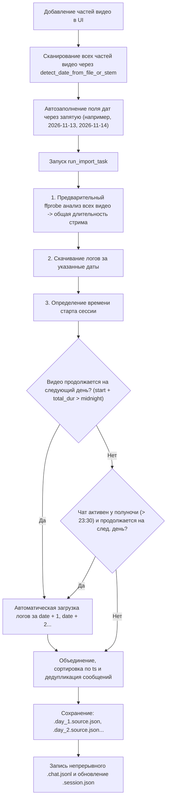

# Handoff: Исправление обрыва чата Twitch при переходе через полночь (23:59:59 UTC)

## 1. Описание проблемы

В архивах Twitch-чатов (например, lurkology / bestlogs) логи хранятся строго по календарным суткам UTC (`/channel/{channel}/{year}/{month}/{day}`).
Когда стрим начинается вечером одного дня и заканчивается ночью следующего дня (например, с `16:18 13.11.2026` до `01:23 14.11.2026 UTC`):

1. **Неполное определение дат в UI**:
   - При добавлении видеофайлов в список импорта дата считывалась только из первого файла. Последующие части (например, `..._2026-11-14 00-45-22...`) игнорировались.
   - В поле дат попадал только один день (`2026-11-13`).
2. **Ограничения регулярных выражений парсинга имен файлов**:
   - В `parse_channel_from_folder` регулярные выражения ожидали разделитель `_` или `T` между датой и временем (`2026-11-13_16-18-14`). Реальные файлы от Streamlink / рекордеров часто содержат пробел: `2026-11-13 16-18-14_720p_Title.mp4`.
   - Из-за этого имена файлов не распознавались как содержащие дату, и fallback брал дату родительской папки (где указан только первый день сессии).
3. **Отсутствие автодогрузки следующего дня в импортере (`importer.rs`)**:
   - Импортер запрашивал только те даты, которые были переданы в параметрах (`params.dates`).
   - Анализ длительности видео выполнялся уже *после* скачивания логов и не влиял на список загружаемых дат.
   - Чат жестко обрывался на последнем сообщении первого дня в `23:59:57 UTC`. Все последующие части видео (начиная с 00:00:00) воспроизводились без оверлея чата.

---

## 2. Архитектура решения

Решение состоит из трёх согласованных уровней:



---

## 3. Необходимые изменения в коде

### Файл 1: `launcher-slint/src/records.rs`

#### 1. Поддержка пробелов и названий в `parse_channel_from_folder`
Заменить регулярные выражения так, чтобы между датой и временем допускались символы `[T_ ]`, а после времени — пробелы, подчеркивания и названия стримов/разрешения:

```rust
pub fn parse_channel_from_folder(folder_name: &str) -> (String, Option<NaiveDateTime>) {
    // 1. DD-MM-YYYY_HH-MM-SS или DD-MM-YYYY HH-MM-SS
    if let Ok(re) = Regex::new(r"^(.*?)_(\d{2}-\d{2}-\d{4}[T_ ]\d{2}[-:]\d{2}[-:]\d{2})(?:[ _].*)?$") {
        if let Some(caps) = re.captures(folder_name) {
            let channel = caps.get(1).unwrap().as_str().trim().trim_start_matches('#').to_string();
            let ts_str = caps.get(2).unwrap().as_str();
            let normalized = ts_str.replace('T', "_").replace(' ', "_").replace(':', "-");
            if let Ok(dt) = NaiveDateTime::parse_from_str(&normalized, "%d-%m-%Y_%H-%M-%S") {
                return (channel, Some(dt));
            }
        }
    }

    // 2. YYYY-MM-DD_HH-MM-SS или YYYY-MM-DD HH-MM-SS (например, channel_2026-11-13 16-18-14)
    if let Ok(re) = Regex::new(r"^(.*?)_(\d{4}-\d{2}-\d{2}[T_ ]\d{2}[-:]\d{2}[-:]\d{2})(?:[ _].*)?$") {
        if let Some(caps) = re.captures(folder_name) {
            let channel = caps.get(1).unwrap().as_str().trim().trim_start_matches('#').to_string();
            let ts_str = caps.get(2).unwrap().as_str();
            let normalized = ts_str.replace('T', "_").replace(' ', "_").replace(':', "-");
            if let Ok(dt) = NaiveDateTime::parse_from_str(&normalized, "%Y-%m-%d_%H-%M-%S") {
                return (channel, Some(dt));
            }
        }
    }

    // 3. YYYYMMDD_HHMMSS (Streamlink default)
    if let Ok(re) = Regex::new(r"^(.*?)_(\d{8}[T_ ]\d{6})(?:[ _].*)?$") {
        if let Some(caps) = re.captures(folder_name) {
            let channel = caps.get(1).unwrap().as_str().trim().trim_start_matches('#').to_string();
            let ts_str = caps.get(2).unwrap().as_str();
            let normalized = ts_str.replace('T', "_").replace(' ', "_");
            if let Ok(dt) = NaiveDateTime::parse_from_str(&normalized, "%Y%m%d_%H%M%S") {
                return (channel, Some(dt));
            }
        }
    }

    // 4. YYYY-MM-DD (Date only)
    if let Ok(re) = Regex::new(r"^(.*?)_(\d{4}-\d{2}-\d{2})(?:[ _].*)?$") {
        if let Some(caps) = re.captures(folder_name) {
            let channel = caps.get(1).unwrap().as_str().trim().trim_start_matches('#').to_string();
            let date_str = caps.get(2).unwrap().as_str();
            if let Ok(d) = chrono::NaiveDate::parse_from_str(date_str, "%Y-%m-%d") {
                if let Some(dt) = d.and_hms_opt(0, 0, 0) {
                    return (channel, Some(dt));
                }
            }
        }
    }

    // 5. DD-MM-YYYY (Date only)
    if let Ok(re) = Regex::new(r"^(.*?)_(\d{2}-\d{2}-\d{4})(?:[ _].*)?$") {
        if let Some(caps) = re.captures(folder_name) {
            let channel = caps.get(1).unwrap().as_str().trim().trim_start_matches('#').to_string();
            let date_str = caps.get(2).unwrap().as_str();
            if let Ok(d) = chrono::NaiveDate::parse_from_str(date_str, "%d-%m-%Y") {
                if let Some(dt) = d.and_hms_opt(0, 0, 0) {
                    return (channel, Some(dt));
                }
            }
        }
    }

    // 6. YYYYMMDD (Date only)
    if let Ok(re) = Regex::new(r"^(.*?)_(\d{8})(?:[ _].*)?$") {
        if let Some(caps) = re.captures(folder_name) {
            let channel = caps.get(1).unwrap().as_str().trim().trim_start_matches('#').to_string();
            let date_str = caps.get(2).unwrap().as_str();
            if let Ok(d) = chrono::NaiveDate::parse_from_str(date_str, "%Y%m%d") {
                if let Some(dt) = d.and_hms_opt(0, 0, 0) {
                    return (channel, Some(dt));
                }
            }
        }
    }

    (folder_name.to_string(), None)
}
```

#### 2. Добавление функции `detect_date_from_file_or_stem`
Позволяет определить точную дату конкретного видеофайла (проверяя `file_stem` до родительской папки):

```rust
pub fn detect_date_from_file_or_stem(video_path: &Path) -> Option<chrono::NaiveDate> {
    // 1. Сначала проверяем stem самого файла (например, nerixane_2026-11-14 00-45-22...)
    if let Some(stem) = video_path.file_stem().and_then(|n| n.to_str()) {
        let (_, dt) = parse_channel_from_folder(stem);
        if let Some(d) = dt {
            return Some(d.date());
        }
    }

    // 2. Если в имени файла даты нет, проверяем имя родительской папки
    if let Some(parent) = video_path.parent() {
        let folder_name = parent.file_name().and_then(|n| n.to_str()).unwrap_or("");
        let (_, dt) = parse_channel_from_folder(folder_name);
        if let Some(d) = dt {
            return Some(d.date());
        }
    }

    None
}
```

---

### Файл 2: `launcher-slint/src/main.rs`

#### 1. Сбор дат со всех добавленных частей в `on_add_import_parts`
Вместо чтения даты только из `first`, сканируем все части:

```rust
    // Автозаполнение канала (nickname) если не указан
    if ui.get_imp_channel().is_empty() {
        for item in list.iter() {
            let (ch_opt, _) = records::detect_channel_and_date(&item.path);
            if let Some(ch) = ch_opt {
                ui.set_imp_channel(ch.into());
                break;
            }
        }
    }

    // Сбор уникальных дат со всех частей видео
    let mut detected_dates = std::collections::BTreeSet::new();
    for item in list.iter() {
        if let Some(d) = records::detect_date_from_file_or_stem(&item.path) {
            detected_dates.insert(d);
        } else if let (_, Some(dt)) = records::detect_channel_and_date(&item.path) {
            detected_dates.insert(dt.date());
        }
    }

    if !detected_dates.is_empty() {
        let dates_str = detected_dates
            .iter()
            .map(|d| d.format("%Y-%m-%d").to_string())
            .collect::<Vec<_>>()
            .join(", ");
        ui.set_imp_dates(dates_str.into());
    }
```

#### 2. В `on_run_import` объединять даты из поля ввода с датами из видеофайлов
```rust
    let mut parsed_dates = Vec::new();
    for part in dates_str.split(',') {
        let trimmed = part.trim();
        if let Ok(d) = chrono::NaiveDate::parse_from_str(trimmed, "%Y-%m-%d") {
            if !parsed_dates.contains(&d) {
                parsed_dates.push(d);
            }
        }
    }
    // Дополнительно страхуем: если видеофайлы содержат даты, которых нет в строке
    for vp in &video_paths {
        if let Some(d) = records::detect_date_from_file_or_stem(vp) {
            if !parsed_dates.contains(&d) {
                parsed_dates.push(d);
            }
        }
    }
    parsed_dates.sort();
    if parsed_dates.is_empty() {
        parsed_dates.push(chrono::Utc::now().date_naive());
    }
```

---

### Файл 3: `launcher-slint/src/importer.rs`

#### 1. Вспомогательные функции извлечения и дедупликации сообщений
```rust
fn extract_and_normalize_messages(day_sources: &[(String, Value)]) -> Vec<ChatRecord> {
    let mut messages_out = Vec::new();
    for (_, source) in day_sources {
        if let Some(messages) = source.get("messages").and_then(|m| m.as_array()) {
            for item in messages {
                if let Some(record) = normalize_message_item(item) {
                    messages_out.push(record);
                }
            }
        } else if let Some(arr) = source.as_array() {
            for item in arr {
                if let Some(record) = normalize_message_item(item) {
                    messages_out.push(record);
                }
            }
        }
    }
    messages_out.sort_by_key(|m| m.ts);
    messages_out
}

fn deduplicate_messages(messages: Vec<ChatRecord>) -> Vec<ChatRecord> {
    let mut seen_ids = HashSet::new();
    let mut unique_messages = Vec::with_capacity(messages.len());
    for msg in messages {
        let key = if !msg.id.is_empty() {
            format!("id:{}", msg.id)
        } else {
            format!("c:{}:{}:{}", msg.ts, msg.user, msg.text)
        };
        if seen_ids.insert(key) {
            unique_messages.push(msg);
        }
    }
    unique_messages
}
```

#### 2. Предварительный ffprobe анализ в начале `run_import_task`
Анализируем длительности видео сразу, чтобы знать общую продолжительность `total_video_duration_ms`:

```rust
    // 1. Probe video files upfront (if any)
    let mut probed_durations = Vec::new();
    let mut total_video_duration_ms = 0i64;
    if !params.video_paths.is_empty() {
        log_fn(format!("Анализ видеофайлов ({}) с помощью ffprobe...", params.video_paths.len()));
        for (i, vp) in params.video_paths.iter().enumerate() {
            let canonical = vp.canonicalize().unwrap_or_else(|_| vp.clone());
            let dur_opt = probe_video_duration_ms(&canonical);
            if let Some(dur) = dur_opt {
                total_video_duration_ms += dur;
                log_fn(format!(
                    "  [Видео {}] {} -> длительность {:.1} с",
                    i + 1,
                    canonical.file_name().unwrap_or_default().to_string_lossy(),
                    dur as f64 / 1000.0
                ));
            } else {
                log_fn(format!(
                    "  [Видео {}] {} -> длительность не определена",
                    i + 1,
                    canonical.file_name().unwrap_or_default().to_string_lossy()
                ));
            }
            probed_durations.push(dur_opt);
        }
    }
```

#### 3. Автодогрузка по длительности видео и по активности чата
После первоначальной загрузки первого дня и вычисления `session_start_ms`:

```rust
    // Автодогрузка по длительности видео
    if total_video_duration_ms > 0 {
        let session_end_ms = session_start_ms + total_video_duration_ms;
        let start_date = DateTime::from_timestamp_millis(session_start_ms).map(|dt| dt.date_naive());
        let end_date = DateTime::from_timestamp_millis(session_end_ms).map(|dt| dt.date_naive());

        if let (Some(s_date), Some(e_date)) = (start_date, end_date) {
            let mut cur = s_date;
            while cur <= e_date {
                if !fetched_dates.contains(&cur) {
                    log_fn(format!(
                        "Видео продолжается до {} ({} UTC). Загрузка лога за {}...",
                        e_date,
                        DateTime::from_timestamp_millis(session_end_ms).unwrap().format("%H:%M:%S"),
                        cur
                    ));
                    let y = cur.format("%Y").to_string();
                    let m = cur.format("%m").to_string();
                    let d = cur.format("%d").to_string();
                    match fetch_day_log(&client, &channel, &y, &m, &d).await {
                        Ok(content) => {
                            day_sources.push((format!("{}-{}-{}", y, m, d), content));
                            fetched_dates.insert(cur);
                        }
                        Err(e) => log_fn(format!("Предупреждение: {}", e)),
                    }
                }
                if let Some(next) = cur.succ_opt() {
                    cur = next;
                } else {
                    break;
                }
            }
        }
    }

    // Автодогрузка по активности чата на стыке суток (если нет видео или видео без точной длительности)
    let mut auto_days_added = 0;
    while auto_days_added < 5 {
        all_messages = extract_and_normalize_messages(&day_sources);

        let max_fetched_date = fetched_dates.iter().max().copied();
        let next_date = match max_fetched_date.and_then(|d| d.succ_opt()) {
            Some(d) => d,
            None => break,
        };

        if fetched_dates.contains(&next_date) {
            break;
        }

        // Последнее сообщение текущего максимального дня
        let last_msg_on_max_date = all_messages
            .iter()
            .rev()
            .find(|m| DateTime::from_timestamp_millis(m.ts).map(|dt| dt.date_naive()) == max_fetched_date);

        let should_probe_next_day = if let Some(last_msg) = last_msg_on_max_date {
            if let Some(last_dt) = DateTime::from_timestamp_millis(last_msg.ts) {
                last_dt.time() >= chrono::NaiveTime::from_hms_opt(23, 30, 0).unwrap()
            } else {
                false
            }
        } else {
            false
        };

        if !should_probe_next_day {
            break;
        }

        let y = next_date.format("%Y").to_string();
        let m = next_date.format("%m").to_string();
        let d = next_date.format("%d").to_string();
        log_fn(format!("Чат продолжался до конца дня {}. Проверка продолжения стрима на {}...", max_fetched_date.unwrap(), next_date));

        match fetch_day_log(&client, &channel, &y, &m, &d).await {
            Ok(content) => {
                let mut next_day_messages = Vec::new();
                if let Some(messages) = content.get("messages").and_then(|m| m.as_array()) {
                    for item in messages {
                        if let Some(record) = normalize_message_item(item) {
                            next_day_messages.push(record);
                        }
                    }
                } else if let Some(arr) = content.as_array() {
                    for item in arr {
                        if let Some(record) = normalize_message_item(item) {
                            next_day_messages.push(record);
                        }
                    }
                }
                next_day_messages.sort_by_key(|m| m.ts);

                if let Some(first_msg) = next_day_messages.first() {
                    let first_dt = DateTime::from_timestamp_millis(first_msg.ts);
                    let last_ts = last_msg_on_max_date.map(|m| m.ts).unwrap_or(0);
                    let gap_ms = first_msg.ts.saturating_sub(last_ts);

                    // Считаем стрим непрерывным, если первое сообщение в течение 1 часа от полуночи ИЛИ разрыв < 45 мин
                    let is_continuous = first_dt.map(|dt| dt.time() <= chrono::NaiveTime::from_hms_opt(1, 0, 0).unwrap()).unwrap_or(false)
                        || gap_ms <= 45 * 60 * 1000;

                    if is_continuous {
                        log_fn(format!(
                            "Обнаружено продолжение чата на {} (первое сообщение: {}, разрыв: {:.1} мин). Добавление дня.",
                            next_date,
                            first_dt.map(|d| d.format("%H:%M:%S UTC").to_string()).unwrap_or_default(),
                            gap_ms as f64 / 60_000.0
                        ));
                        day_sources.push((format!("{}-{}-{}", y, m, d), content));
                        fetched_dates.insert(next_date);
                        auto_days_added += 1;
                        continue;
                    } else {
                        log_fn(format!(
                            "На {} первое сообщение только в {} (разрыв {:.1} ч) — новый стрим, пропуск.",
                            next_date,
                            first_dt.map(|d| d.format("%H:%M:%S UTC").to_string()).unwrap_or_default(),
                            gap_ms as f64 / 3_600_000.0
                        ));
                        break;
                    }
                } else {
                    log_fn(format!("На {} сообщений не найдено.", next_date));
                    break;
                }
            }
            Err(e) => {
                log_fn(format!("Лог за {} недоступен: {}", next_date, e));
                break;
            }
        }
    }

    // Сортировка исходников по датам
    day_sources.sort_by(|a, b| a.0.cmp(&b.0));

    // Итоговое извлечение и дедупликация
    all_messages = deduplicate_messages(extract_and_normalize_messages(&day_sources));
```

#### 4. Сохранение всех исходников
```rust
    let mut source_files = Vec::new();
    for (i, (_, source)) in day_sources.iter().enumerate() {
        let source_fn = format!("{}.day_{}.source.json", folder_name, i + 1);
        let source_path = session_dir.join(&source_fn);
        if let Ok(content) = serde_json::to_string_pretty(source) {
            let _ = fs::write(&source_path, content);
            source_files.push(source_fn);
        }
    }
```
В `session.json` попадает массив `source_files: ["...day_1.source.json", "...day_2.source.json"]`.

---